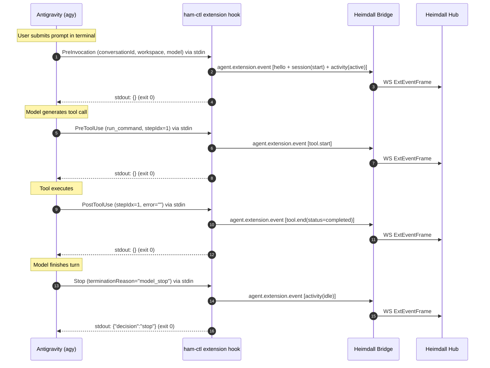
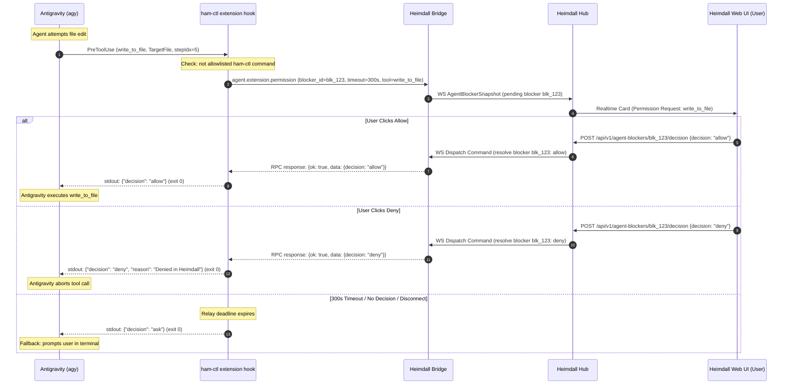
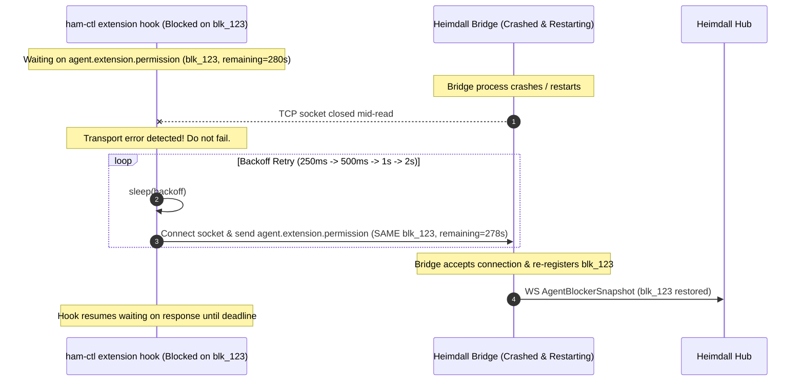
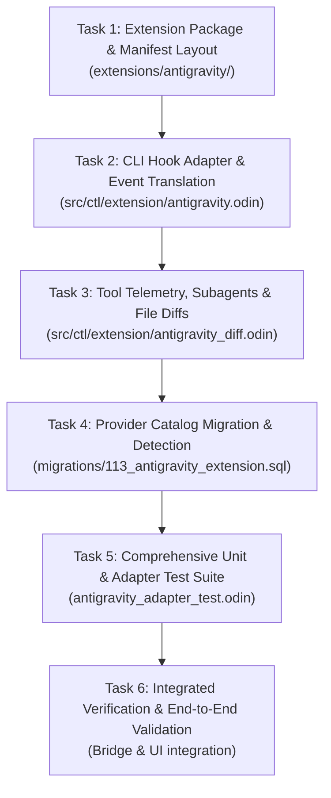

# Antigravity Provider Extension Architecture & Execution Plan

Task: `task_18e141f48f10e550` (T1) · Chain: Create Antigravity extension for Heimdall (`chain_18e141189520817f`)  
Author: worker (`inst_18e141f48f68c231`, `agt_worker_tanmay`)  
Coordinator: `inst_18e14118952bf7ca`  
Status: **PROPOSED / READY FOR REVIEW**  
Date: 2026-10-23  

---

## 1. Executive Summary & Product Motivation

Heimdall manages multiple AI coding agent harnesses (Claude Code, Codex, Copilot, Antigravity, Pi). To provide real-time user observability and control in the Heimdall UI (activity status, tool invocations, subagent hierarchies, file-edit diffs, and interactive permission approvals), Heimdall utilizes provider extensions that intercept native harness events.

### 1.1 The Problem with Terminal Screen-Scraping
Previously, Antigravity (`agy`) integration in Heimdall relied on legacy terminal pane capture (`source=pane_diff`) or unconstrained flags (`--dangerously-skip-permissions`):
1. **High Latency & Resource Consumption**: Polling tmux pane diffs burns CPU and delays activity state transitions by multiple seconds.
2. **Loss of Structural Telemetry**: Terminal screen output is unstructured ANSI text. Tool arguments, step indices, exact tool execution responses, and error codes are lost or unreliable to parse.
3. **No Interactive Permission Gating**: In `permission_mode: ask`, Heimdall must present approval cards to the user before destructive commands or edits run. Screen scraping cannot pause execution cleanly or inject user decisions back into Antigravity.
4. **Lack of Subagent Visibility**: Antigravity subagents (`invoke_subagent`, `define_subagent`) execute asynchronously. Screen scraping cannot attribute tool calls or subagent lifecycles to their parent conversations.
5. **Missing File Edit Diffs**: Without hook-level interception of file tools (`write_to_file`, `replace_file_content`), the Heimdall attention deck and chat cannot display visual syntax-highlighted diffs.

### 1.2 The Native Extension Solution
Antigravity 1.2+ provides a rich Customization and Plugin Architecture with deterministic lifecycle hooks (`PreInvocation`, `PostInvocation`, `PreToolUse`, `PostToolUse`, `Stop`), plugin manifests (`plugin.json`), and CLI management (`agy plugin`).

This document defines the architectural specification and implementation breakdown for the **Antigravity Provider Extension for Heimdall**. The extension normalizes Antigravity's native protojson hook events into Heimdall's provider-neutral `ham.ext.v1` protocol, enabling exact, zero-overhead telemetry and interactive human-in-the-loop permission approvals.

---

## 2. Requirements Specification

The extension is governed by four core requirements: `REQ-EXT-AGY-1` through `REQ-EXT-AGY-4`.

| Requirement ID | Name | Summary |
|---|---|---|
| **REQ-EXT-AGY-1** | Packaging, Manifest & Discovery | Standalone plugin package layout (`plugin.json`, `hooks.json`, `README.md`), catalog registration in SQLite, detection probe (`agy plugin list`), and support for read-only Nix-managed environments. |
| **REQ-EXT-AGY-2** | Protocol Normalization & Event Mapping | Normalization of Antigravity protojson hook payloads to `ham.ext.v1` (`hello`, `session`, `activity`, `tool.start`, `tool.end`). Bounded inputs, fail-open semantics, and safe execution outside Heimdall. |
| **REQ-EXT-AGY-3** | Interactive Permission Relay & Blocker Coordination | Interception of `PreToolUse` for permission gating, bridge relay via `agent.extension.permission`, stable blocker IDs with backoff re-registration across bridge restarts, fallback to terminal prompts, and local auto-approval of `ham-ctl` coordination commands. |
| **REQ-EXT-AGY-4** | Tool Lifecycle, Subagent Tracking & File Edit Diffs | Structured tool telemetry (`tool.start` / `tool.end`), subagent invocation tracking (`invoke_subagent`), and real-time generation of unified diffs for mutating file tools (`write_to_file`, `replace_file_content`) capped at 64KB. |

---

### REQ-EXT-AGY-1: Packaging, Manifest & Bridge Discovery

1. **Repository Layout**:
   The extension package shall reside in `extensions/antigravity/` with the following structure:
   ```text
   extensions/antigravity/
   ├── plugin.json                 # Antigravity plugin manifest (name: "heimdall", version: "0.1.0")
   ├── README.md                   # Installation, usage, and diagnostic documentation
   └── hooks/
       └── hooks.json              # Hook registration mapping lifecycle events to ham-ctl
   ```
2. **Hook Declaration (`hooks.json`)**:
   Every hook event shall invoke the provider-agnostic CLI handler:
   ```json
   {
     "heimdall": {
       "PreInvocation": [
         { "type": "command", "command": "\"$HEIMDALL_CTL_BIN\" extension hook antigravity", "timeout": 10 }
       ],
       "PostInvocation": [
         { "type": "command", "command": "\"$HEIMDALL_CTL_BIN\" extension hook antigravity", "timeout": 10 }
       ],
       "PreToolUse": [
         {
           "matcher": "*",
           "hooks": [
             { "type": "command", "command": "\"$HEIMDALL_CTL_BIN\" extension hook antigravity", "timeout": 330 }
           ]
         }
       ],
       "PostToolUse": [
         {
           "matcher": "*",
           "hooks": [
             { "type": "command", "command": "\"$HEIMDALL_CTL_BIN\" extension hook antigravity", "timeout": 30 }
           ]
         }
       ],
       "Stop": [
         { "type": "command", "command": "\"$HEIMDALL_CTL_BIN\" extension hook antigravity", "timeout": 10 }
       ]
     }
   }
   ```
3. **Provider Catalog Registration**:
   A new SQLite migration (`src/hub/repository/sqlite/migrations/113_antigravity_extension.sql`) shall update `provider_catalog` for `provider = 'antigravity'`:
   - `extension`: JSON descriptor declaring:
     - `detect_argv`: `["plugin", "list", "--json"]`
     - `detect_collection`: `"installed"` (or empty/legacy array format)
     - `detect_id_key`: `"name"`
     - `detect_version_key`: `"version"`
     - `detect_enabled_key`: `"enabled"`
     - `plugin_id`: `"heimdall"`
     - `min_version`: `"0.1.0"`
     - `install_hint`: `"agy plugin install <repo>/extensions/antigravity"`
     - `capabilities`: `["activity", "subagents", "permissions", "file_edits", "session_id"]`
     - `load_args`: `["--add-dir"]`
     - `load_path_suffix`: `"extensions/antigravity"`
4. **Read-Only Filesystem & Nix Homelab Compatibility**:
   - In Nix-managed environments, `~/.gemini/hooks.json` is commonly a symlink into the read-only Nix store (`/nix/store/...-home-manager-files/.gemini/hooks.json`).
   - The extension installation must never write directly to or attempt to overwrite read-only symlinks in `~/.gemini/`.
   - Instead, the Bridge launch recipe shall load the extension via workspace project discovery (`.agents/plugins/` or `--add-dir extensions/antigravity`), or using `plugins.json` configuration inheritance.
5. **Zero-Side-Effect Outside Heimdall**:
   - When launched in a standalone developer terminal without Heimdall, `HEIMDALL_CTL_BIN` is unset. Each hook invocation must exit 0 immediately with empty stdout.
   - If `HEIMDALL_CTL_BIN` is set but `HEIMDALL_BRIDGE_ENDPOINT` or `HEIMDALL_AGENT_TOKEN` are absent or whitespace, the hook must exit 0 immediately and print nothing.

---

### REQ-EXT-AGY-2: Protocol Normalization & Event Mapping

1. **Native Input Ingestion**:
   - The CLI command `ham-ctl extension hook antigravity` reads Antigravity's protojson context from `stdin`.
   - All incoming payloads adhere to camelCase protojson:
     - `conversationId`: Unique string ID of the session.
     - `workspacePaths`: Array of absolute workspace directory strings.
     - `transcriptPath`: Path to the active `transcript.jsonl`.
     - `modelName`: Model identifier (e.g. `gemini-3.8-flash-high`).
     - `stepIdx`: Integer step index within the execution trajectory.
     - `invocationNum`: Integer count of the model invocation turn.
2. **Payload Boundaries & Resource Limits**:
   - `AGY_HOOK_INPUT_MAX :: 16 * 1024 * 1024` (16MB): Payloads exceeding this limit return parse error / no-op.
   - `AGY_TOOL_STRING_MAX :: 4 * 1024` (4KB): Tool arguments and return strings clipped to 4KB.
   - Aggregate batch bound: Total events per hook call must stay under `contracts.EXT_BATCH_MAX_BYTES` (4MB).
3. **Event Normalization to `ham.ext.v1`**:
   The adapter in `src/ctl/extension/antigravity.odin` maps hook events to `ham.ext.v1` structures:
   - **`PreInvocation`**:
     - On first invocation for a session: Emits `hello` (capabilities) and `session` (`phase: "start"`, `cwd`, `model`, `transcript_path`).
     - Emits `activity` (`state: "active"`, `reason: "user_prompt"`).
     - Hook stdout: `{}`.
   - **`PostInvocation`**:
     - Emits turn telemetry if needed.
     - Hook stdout: `{}`.
   - **`PreToolUse`**:
     - Emits `tool.start` (`tool_name`, `tool_use_id`, `input`).
     - Gated permission requests route to `agent.extension.permission` (see REQ-EXT-AGY-3).
     - Hook stdout: `{}` or permission decision JSON.
   - **`PostToolUse`**:
     - Emits `tool.end` (`tool_name`, `tool_use_id`, `status: "completed" | "error"`, `outcome`).
     - If tool edited files: Emits `file.edit` (see REQ-EXT-AGY-4).
     - Hook stdout: `{}`.
   - **`Stop`**:
     - Emits `activity` (`state: "idle"`, `reason: terminationReason`, `fully_idle` when present).
     - Never emits `session` (`phase: "end"`): Stop fires once per execution loop (turn), and agy's
       Stop payload (`executionNum`, `terminationReason`, `error`, `fullyIdle`, `finalModelOutput`)
       has no session-termination signal; agy has no `SessionEnd` hook. The session ends with the
       agent process. A per-turn session end would reset live tool state, dropping background subagent calls.
     - A Stop carrying `agentId` (a child agent's loop ended) emits `subagent.stop` instead.
     - Hook stdout: `{ "decision": "stop" }` or `{}`.
4. **Transport & Timeout Rules**:
   - Non-permission events are sent to the local Bridge socket using method `agent.extension.event` with a 500ms socket timeout (`EVENT_SOCKET_TIMEOUT_MS`).
   - Standard stdout for non-permission hooks is strictly EMPTY. Non-empty stdout in Antigravity hook scripts can inject unwanted prompt tokens into the model.

---

### REQ-EXT-AGY-3: Interactive Permission Relay & Blocker Coordination

1. **Permission Interception via `PreToolUse`**:
   - In `permission_mode: ask`, before executing potentially destructive tools (`run_command`, `write_to_file`, `replace_file_content`), the hook checks whether user approval is required.
2. **Local Auto-Approval of Coordination Commands**:
   - Agents coordinate with Heimdall via `ham-ctl` (`chat send`, `task comment`, `lease heartbeat`, etc.).
   - If `toolCall.name == "run_command"` and `toolCall.args.CommandLine` is an allowlisted `ham-ctl` command verified by `is_ham_ctl_command`, the hook must approve it locally at once.
   - The hook immediately prints `{"decision": "allow"}` and exits 0, generating neither an agent blocker nor a bridge permission RPC round-trip.
3. **Bridge Permission Relay (`agent.extension.permission`)**:
   - For all non-whitelisted tool calls requiring permission:
     - Formulate `permission.request` event with a unique `blocker_id` (`blk_<timestamp>_<random>`), timeout budget (default 300s, `PERMISSION_RELAY_TIMEOUT_MS`), tool name, tool use ID, and clipped input summary.
     - Block on the Bridge socket calling `agent.extension.permission`.
4. **Restart Safety & Blocker Re-Registration**:
   - If the Heimdall Bridge restarts while an agent's hook is blocked:
     - The hook process remains the authoritative source of truth for the blocker.
     - Upon socket disconnection or transport failure, the hook attempts reconnection with exponential backoff (250ms to 2000ms).
     - Upon reconnection, it re-registers the **SAME** `blocker_id` with the remaining timeout budget until the deadline is reached.
     - The Bridge recovers its in-memory blocker state without loss.
5. **Decision Translation**:
   - User clicks **Allow** in UI: Bridge returns `{"ok":true,"data":{"decision":"allow"}}`.
     - Hook prints to stdout: `{"decision": "allow"}`.
   - User clicks **Deny** in UI: Bridge returns `{"ok":true,"data":{"decision":"deny","message":"..."}}`.
     - Hook prints to stdout: `{"decision": "deny", "reason": "Denied in Heimdall"}`.
   - **Timeout / Transport Failure / No Decision**:
     - Hook budget expires (or Bridge is unreachable): Hook prints `{"decision": "ask"}`.
     - Falling back to `"ask"` delegates the decision to Antigravity's interactive terminal prompt. Execution is never permanently hung.

---

### REQ-EXT-AGY-4: Tool Lifecycle, Subagent Tracking & File Edit Diffs

1. **Tool Invocations & Identifiers**:
   - Tool names are preserved from Antigravity's schema: `run_command`, `view_file`, `write_to_file`, `replace_file_content`, `read_url_content`, `search_web`, `invoke_subagent`, `send_message`, `manage_task`, `schedule`.
   - Tool use ID is formulated as `step_<stepIdx>` to ensure determinism across `PreToolUse` and `PostToolUse` pairing.
2. **Subagent Detection & Lifecycles**:
   - When `toolCall.name == "invoke_subagent"`:
     - Extract subagent roles, types, and model specifications from `toolCall.args.Subagents`.
     - Emit `subagent.start` event carrying target agent identifier.
   - When subagent completes or sends a terminating message:
     - Emit `subagent.stop` event (mapped from a `Stop` hook that carries `agentId`).
   - If hook input carries subagent context (`agent_id`, `agent_type`), attach it to the `ham.ext.v1` envelope so tool events are attributed to the child agent.
3. **File Edit Extraction & Unified Diffs**:
   - When mutating tools complete successfully in `PostToolUse`:
     - **`write_to_file`**:
       - Extract `TargetFile`, `CodeContent`, `Append`, and `Overwrite`.
       - Generate unified diff representation representing file creation or replacement.
     - **`replace_file_content`**:
       - Extract `TargetFile`, `TargetContent`, and `ReplacementContent`.
       - Generate unified diff showing removed `TargetContent` and inserted `ReplacementContent`.
   - **Diff Sizing & Truncation**:
     - Unified diff string capped at `contracts.EXT_DIFF_MAX_BYTES` (64KB).
     - Diffs exceeding 64KB are truncated cleanly at line boundaries with the marker `\n…[truncated by heimdall]`.
     - Binary files and non-diffable content are omitted from `file.edit`.
     - Emit `file.edit` event to the Bridge immediately following `tool.end`.

---

## 3. Architecture & Data Flow

### 3.1 Normal Turn Execution Flow


---

### 3.2 Interactive Permission Relay Flow (`permission_mode: ask`)


---

### 3.3 Bridge Restart & Blocker Re-Registration


---

## 4. Implementation Breakdown & Execution Tasks

The implementation is structured into 6 sequential, test-backed execution tasks:



---

### Task 1: Extension Package & Manifest Layout
- **Goal**: Create the Antigravity plugin package conforming to the Antigravity Customization System.
- **Assignee**: `agt_worker_tanmay`
- **Files to Create/Modify**:
  - `extensions/antigravity/plugin.json`: Plugin manifest declaring `name: "heimdall"`, version `0.1.0`.
  - `extensions/antigravity/hooks/hooks.json`: Lifecycle hook definitions for `PreInvocation`, `PostInvocation`, `PreToolUse`, `PostToolUse`, `Stop` invoking `"$HEIMDALL_CTL_BIN" extension hook antigravity`.
  - `extensions/antigravity/README.md`: User and operator documentation detailing installation, CLI behavior outside Heimdall, permission models, and diagnostics.
  - `extensions/antigravity/.agents/plugins/marketplace.json`: (Optional) Marketplace metadata if registered locally.
- **Verification Command**:
  ```bash
  agy plugin validate extensions/antigravity
  ```
- **Acceptance Criteria**:
  - `plugin.json` validates successfully with `agy plugin validate`.
  - All five lifecycle events mapped to `"$HEIMDALL_CTL_BIN" extension hook antigravity`.
  - Timeouts configured: 10s for invocation/stop, 330s for PreToolUse, 30s for PostToolUse.

---

### Task 2: CLI Hook Adapter & Event Translation
- **Goal**: Implement Antigravity hook payload parsing, protojson normalization, and `ham.ext.v1` event generation in `ham-ctl`.
- **Assignee**: `agt_worker_tanmay`
- **Files to Create/Modify**:
  - `src/ctl/extension/antigravity.odin`: Main Antigravity adapter implementation (`antigravity_map_hook`, `antigravity_build_permission`, `antigravity_permission_output`).
  - `src/ctl/extension/hook.odin`: Integrate `ANTIGRAVITY_PROVIDER :: "antigravity"` into `hook_run` switch.
  - `src/ctl/extension_cmds.odin`: Add `antigravity` to valid providers in CLI argument verification.
- **Verification Command**:
  ```bash
  nix develop . --command odin test src/ctl/extension -collection:odin_test=src -define:ODIN_TEST_NAMES=extension.test_antigravity_adapter
  ```
- **Acceptance Criteria**:
  - Parses camelCase protojson fields: `conversationId`, `workspacePaths`, `transcriptPath`, `modelName`, `stepIdx`, `invocationNum`.
  - Emits `hello`, `session`, and `activity` events conforming to `contracts.EXT_SCHEMA_V1`.
  - Strict input capping: Payloads over 16MB rejected; tool strings clipped to 4KB.
  - Fail-open: Empty output and exit code 0 on missing environment variables or parsing errors.

---

### Task 3: Tool Telemetry, Subagents & File Diffs
- **Goal**: Add tool event lifecycle tracking (`tool.start`/`tool.end`), subagent detection (`invoke_subagent`), and file edit extraction (`file.edit`) with unified diff generation.
- **Assignee**: `agt_worker_tanmay`
- **Files to Create/Modify**:
  - `src/ctl/extension/antigravity.odin`: Tool lifecycle mapping and subagent event synthesis.
  - `src/ctl/extension/antigravity_diff.odin`: Diff generation logic for `write_to_file` and `replace_file_content`.
  - Reuses `src/ctl/extension/diff.odin`: Unified diff generator capped at `EXT_DIFF_MAX_BYTES` (64KB).
- **Verification Command**:
  ```bash
  nix develop . --command odin test src/ctl/extension -collection:odin_test=src -define:ODIN_TEST_NAMES=extension.test_antigravity_diff
  ```
- **Acceptance Criteria**:
  - `PreToolUse` generates `tool.start` with unique `tool_use_id = "step_<stepIdx>"`.
  - `PostToolUse` generates `tool.end` with execution status (`completed` or `error`).
  - `invoke_subagent` calls emit `subagent.start` with target role and parameters.
  - `write_to_file` and `replace_file_content` produce valid unified diffs capped at 64KB with `EXT_TRUNCATED_MARKER` when clipped.

---

### Task 4: Interactive Permission Relay & Coordination
- **Goal**: Wire `PreToolUse` permission gating, local `ham-ctl` auto-approval, Bridge blocker registration, and fallback handling.
- **Assignee**: `agt_worker_tanmay`
- **Files to Create/Modify**:
  - `src/ctl/extension/antigravity.odin`: Permission request formulation, response parsing, and stdout formatting (`{"decision": "allow" | "deny" | "ask"}`).
  - `src/ctl/extension/hook.odin`: Ensure `is_ham_ctl_command` checks apply to Antigravity's `run_command` arguments (`CommandLine`).
- **Verification Command**:
  ```bash
  nix develop . --command odin test src/ctl/extension -collection:odin_test=src -define:ODIN_TEST_NAMES=extension.test_antigravity_permission
  ```
- **Acceptance Criteria**:
  - Allowlisted `ham-ctl` commands auto-approved locally without hitting the Bridge socket.
  - `permission.request` generated with stable `blocker_id` and clamped 300s timeout.
  - Restart resilience: Re-registers the same `blocker_id` on transport drop with backoff.
  - Timeout or transport disconnect yields `{"decision": "ask"}`.

---

### Task 5: Provider Catalog Migration & Detection
- **Goal**: Register the Antigravity extension descriptor in the Hub catalog and update Bridge detection.
- **Assignee**: `agt_worker_tanmay`
- **Files to Create/Modify**:
  - `src/hub/repository/sqlite/migrations/113_antigravity_extension.sql`: Migration updating `provider_catalog.extension` for `provider = 'antigravity'`.
  - `src/hub/repository/sqlite/migrations.odin`: Register migration 113.
  - `src/ctl/setup.odin`: Update `wire_hint` and `install_hint` for Antigravity in `ham-ctl setup`.
- **Verification Command**:
  ```bash
  nix develop . --command odin test src/hub/repository/sqlite -collection:odin_test=src -define:ODIN_TEST_NAMES=sqlite.test_antigravity_extension_catalog
  ```
- **Acceptance Criteria**:
  - Migration applies cleanly and updates catalog metadata etag.
  - Bridge probe runs `agy plugin list --json` and correctly identifies `present`, `absent`, or `outdated` states.
  - `bridge_provider_launch_extension_expected` identifies extension load path.

---

### Task 6: Unit, Adapter & Fixture Verification
- **Goal**: Full unit and fixture regression test suite verifying real-world Antigravity payloads against the contract.
- **Assignee**: `agt_worker_tanmay`
- **Files to Create/Modify**:
  - `src/ctl/extension/antigravity_adapter_test.odin`: Unit test suite covering all lifecycle events, permissions, diffs, subagents, error bounds, and auto-approval.
  - `src/ctl/extension/testdata/antigravity_pre_invocation.json`
  - `src/ctl/extension/testdata/antigravity_pre_tool_use.json`
  - `src/ctl/extension/testdata/antigravity_post_tool_use.json`
  - `src/ctl/extension/testdata/antigravity_stop.json`
- **Verification Command**:
  ```bash
  nix develop . --command odin test src/ctl/extension -collection:odin_test=src
  ```
- **Acceptance Criteria**:
  - 100% of adapter tests pass cleanly.
  - No memory leaks under Odin tracking allocator.
  - Fixtures match observed Antigravity 1.2+ CLI protojson outputs.

---

## 5. Risks, Edge Cases & Mitigation Strategies

| Risk / Edge Case | Impact | Severity | Mitigation Strategy |
|---|---|---|---|
| **Read-only Nix Store symlinks** | Writing `hooks.json` to `~/.gemini/` fails with `EROFS` / `Permission denied` on NixOS/Home-Manager. | High | Package extension as a standalone plugin under `extensions/antigravity/` and load via project workspace `.agents/plugins/` or `--add-dir`, without touching `~/.gemini/`. |
| **Hook Budget Timeout Desynchronization** | If Antigravity hook timeout expires before Heimdall UI decision, Antigravity kills the hook or aborts. | Medium | Configure `PreToolUse` hook timeout to 330s in `hooks.json`. Bridge relay timeout is clamped to 300s (`PERMISSION_RELAY_TIMEOUT_MS`). The 30s margin guarantees clean fallback to `{"decision":"ask"}` before hook death. |
| **Protojson camelCase vs Snake Case** | Unmarshaling fails if parser expects snake_case (`conversation_id` vs `conversationId`). | Medium | The Antigravity adapter explicitly inspects camelCase keys (`conversationId`, `workspacePaths`, `transcriptPath`, `modelName`, `stepIdx`, `toolCall`) with fallback to snake_case. |
| **Large File Diffs in `write_to_file`** | Whole-file writes in `write_to_file` can generate massive diff payloads exceeding Bridge message limits. | Medium | Diffs are computed line-by-line and strictly truncated at `contracts.EXT_DIFF_MAX_BYTES` (64KB) with `EXT_TRUNCATED_MARKER`. Payloads stay well within the 256KB single-event bound. |
| **Recursive Permission Deadlock on `ham-ctl`** | If `ham-ctl` agent coordination commands trigger a permission prompt, the agent cannot answer its own blocker. | Critical | `is_ham_ctl_command` inspects shell commands against an allowlist of read-only / coordination verbs (`chat`, `task`, `lease`, `verify`, `extension`, `agent start-success`) and immediately auto-approves locally. |
| **Missing Before-File Preimage for Edits** | If Antigravity modifies a file on disk without providing original text, diff cannot be generated from memory. | Low | For `replace_file_content`, target and replacement chunks provide exact replacement context. For `write_to_file`, the new content is rendered as a clean file-creation diff (`+++ b/file`). |
| **Non-Zero Hook Exits Halting Agent Loop** | If `ham-ctl` crashes or errors, Antigravity may abort the entire conversation. | High | Hook handler wraps all execution in `fail-open`: any unhandled error, invalid JSON, or transport fault returns exit code 0 and empty stdout (or `{"decision":"ask"}` during permission). |

---

## 6. Review Gates & Verification Criteria

Submission of implementation tasks requires satisfying the following verification criteria:
1. **Automated Unit Tests**:
   - `nix develop . --command odin test src/ctl/extension -collection:odin_test=src` passes with 0 failures.
   - `nix develop . --command odin test src/hub/repository/sqlite -collection:odin_test=src` passes migration verification.
2. **Plugin Validation**:
   - `agy plugin validate extensions/antigravity` reports clean validation.
3. **End-to-End Simulation**:
   - Simulated hook execution with test fixtures produces byte-accurate `ham.ext.v1` events matching schema.
   - Permission simulation correctly resolves allow, deny, timeout, and reconnect scenarios.
